## {.bez-tytulu background-image="images/tlo_tytul.png" background-size="cover" background-opacity="0.28"}

::: {.absolute top="238" left="56" width="1100"}
[Zastosowanie interpretowalnego uczenia maszynowego w analizie danych geoprzestrzennych na przykładzie danych demograficznych USA]{.tytul-glowny}
:::

::: {.absolute top="420" left="56" width="1100"}
[XXXIII Konferencja Polskiego Towarzystwa Informacji Przestrzennej, Warszawa, 28–29 października 2026]{.tytul-konferencja}
:::

::: {.absolute top="544" left="56" width="1100"}
**Adrian Nowacki**

Uniwersytet im. Adama Mickiewicza w Poznaniu
:::

## Wprowadzenie [Wprowadzenie]{.etap}

::: {.absolute .justify top="121" left="64" width="1152"}
Geografia dysponuje coraz większymi zbiorami danych geoprzestrzennych, odznaczających się **dużą liczbą zmiennych** oraz **wysokim poziomem współzależności**.
:::

::: {.absolute .justify top="250" left="64" width="434"}
- Dane te są często zbyt złożone, aby można je było interpretować za pomocą klasycznych metod statystycznych.
- Aby opisać nieliniowe zależności danych, można użyć **metod uczenia maszynowego**.
- Wiele zaawansowanych modeli pozwala wykryć złożone wzorce bez ujawniania struktury podejmowanych decyzji.
:::

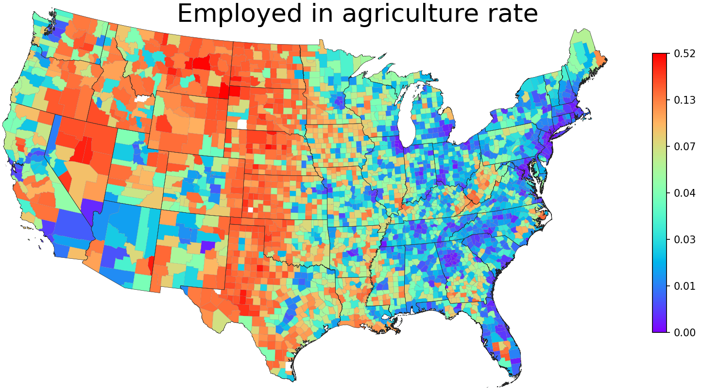{.absolute top="217" left="553" width="663" height="371"}

::: {.absolute .center-text top="612" left="64" width="1152"}
**Zastosowanie interpretowalnego uczenia maszynowego jest niezbędne do zrozumienia relacji między czynnikami społeczno-demograficznymi a zmiennymi objaśnianymi**
:::

## Cel [Wprowadzenie]{.etap}

::: {.absolute .justify top="129" left="64" width="1152"}
Celem wystąpienia jest przedstawienie procedury, która **łączy analizę składowych głównych (PCA), uczenie maszynowe i dekompozycję modelu wartościami SHAP.**
:::

::: {.absolute top="284" left="64" width="1152"}
Procedurę przedstawiono na dwóch przykładach zjawisk społecznych opisanych dla hrabstw USA. Zmienną zależną jest w nich:
:::

::: {.absolute .ramka top="330" left="64" width="566" height="125"}
[Przykład 1]{.etykieta}

**Poziom segregacji rasowo-etnicznej,<br>1990–2020**
:::

::: {.absolute .ramka top="330" left="650" width="566" height="125"}
[Przykład 2]{.etykieta}

**Wynik wyborów prezydenckich,<br>2008–2024**
:::

::: {.absolute top="537" left="64" width="1152"}
**Główny problem:**

Trudność w uzyskaniu interpretowalnych wyników z powodu wysokiej złożoności przestrzenno-czasowej danych.
:::

## Dane i narzędzia [Wprowadzenie]{.etap}

{.absolute top="147" left="96" width="252" height="105"}

{.absolute top="115" left="493" width="285" height="160"}

{.absolute top="127" left="860" width="356" height="125"}

```{=html}
<svg class="absolute" style="position:absolute;top:0;left:0;pointer-events:none" width="1280" height="720" viewBox="0 0 1280 720">
  <defs><marker id="grot4" markerWidth="8" markerHeight="8" refX="7" refY="4" orient="auto"><path d="M0 0L8 4L0 8z" fill="#4A5A53"/></marker></defs>
  <path d="M222 258 Q222 306 333 306" fill="none" stroke="#4A5A53" stroke-width="1.2" marker-end="url(#grot4)"/>
  <path d="M635 278 Q635 306 482 306" fill="none" stroke="#4A5A53" stroke-width="1.2" marker-end="url(#grot4)"/>
  <path d="M635 278 Q635 306 772 306" fill="none" stroke="#4A5A53" stroke-width="1.2" marker-end="url(#grot4)"/>
  <path d="M1100 258 Q1100 306 921 306" fill="none" stroke="#4A5A53" stroke-width="1.2" marker-end="url(#grot4)"/>
</svg>
```

::: {.absolute .center-text top="290" left="330" width="156"}
**Przykład 1<br>(segregacja)**
:::

::: {.absolute .center-text top="290" left="777" width="139"}
**Przykład 2<br>(wybory)**
:::

::: {.absolute .justify top="420" left="60" width="817"}
IPUMS NHGIS udostępnia szczegółowe dane społeczno-ekonomiczne i demograficzne o populacji USA ze **spisów powszechnych** i **projektu ACS**.

Repozytorium GitHub udostępnia oficjalne wyniki stanowe, zawierające liczbę oddanych głosów, różnice głosów oraz odsetki głosów uzyskane przez poszczególnych kandydatów.
:::

{.absolute top="411" left="1104" width="112" height="87"}

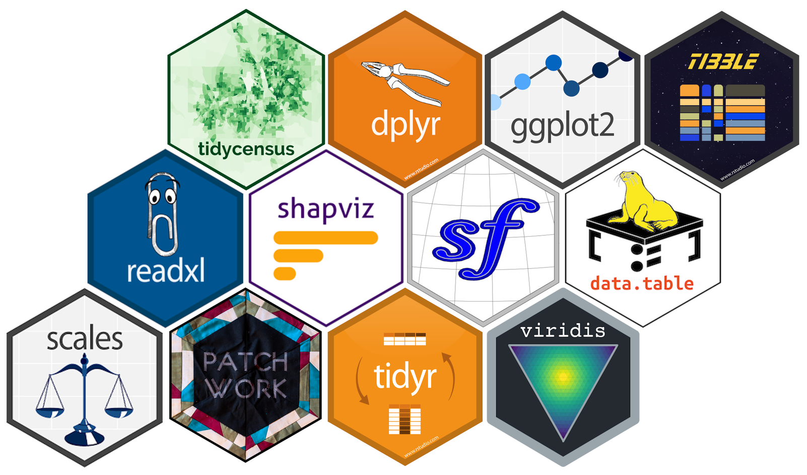{.absolute top="515" left="925" width="291" height="172"}

## Schemat procedury [Wprowadzenie]{.etap}

::: {.aktywny-0}

:::

## {.bez-tytulu background-color="#436B5C"}

::: {.absolute .rozdzial top="276" left="66" width="1099"}
[Przykład 1]{.nr}

[Poziom segregacji rasowo-etnicznej]{.nazwa}
:::

::: {.absolute .rozdzial top="466" left="66" width="1099"}
Identyfikacja czynników społeczno-demograficznych kształtujących segregację rasowo-etniczną w Stanach Zjednoczonych w latach 1990–2020
:::

## I. Dane [I. Dane]{.etap}

::: {.aktywny-1}

:::

## Wskaźniki segregacji [I. Dane]{.etap}

::: {.absolute .ramka top="138" left="64" width="586" height="140"}
**Wskaźnik niepodobieństwa D**

mierzy stopień nierównomiernego rozkładu dwóch grup populacji w poszczególnych jednostkach przestrzennych.
:::

::: {.absolute .ramka top="138" left="650" width="566" height="140"}
**Wskaźnik teorii informacji H**

mierzy stopień, w jakim skład rasowy i etniczny jednostek różni się od składu całego badanego obszaru
:::

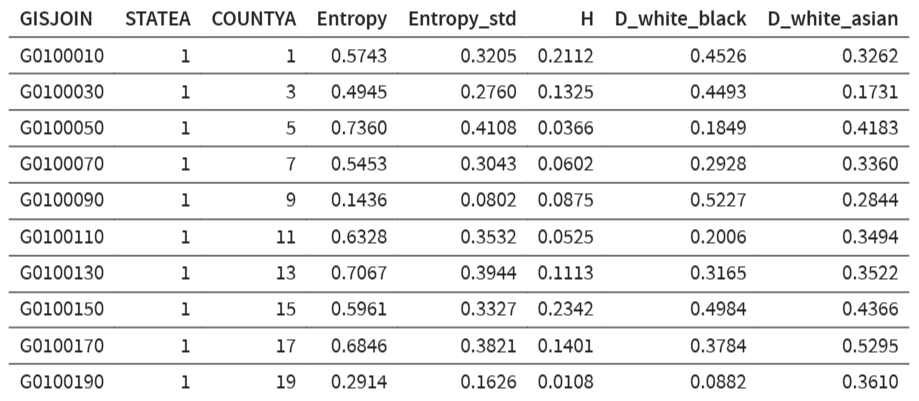{.absolute top="330" left="51" width="701" height="311"}

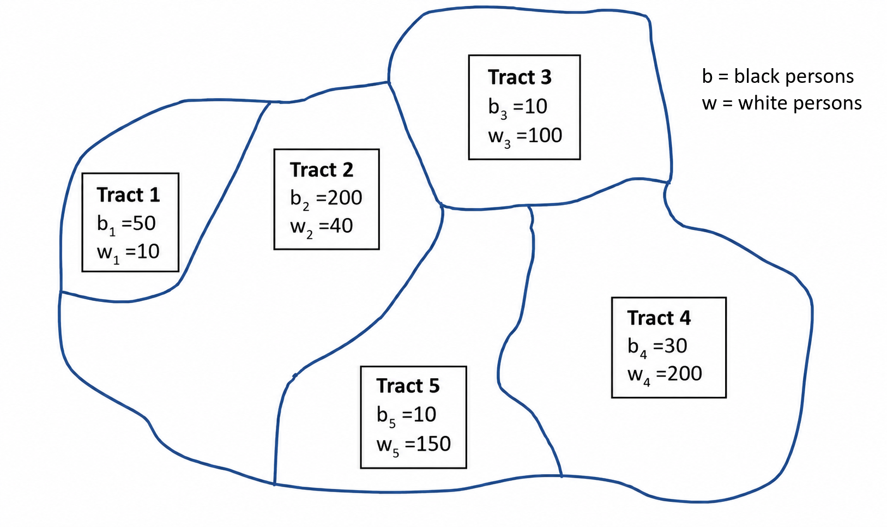{.absolute top="338" left="738" width="497" height="295"}

## Zmienne społeczno-demograficzne [I. Dane]{.etap}

::: {.absolute .justify top="125" left="64" width="1152"}
Wybrano zmienne reprezentujące **szerokie spektrum charakterystyk społeczno-demograficznych gospodarstw**, m.in. strukturę płci i wieku, dochody, wykształcenie, warunki mieszkaniowe i zatrudnienie.
:::

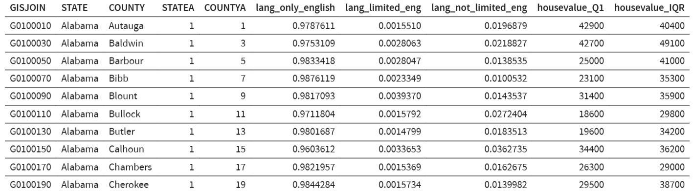{.absolute top="238" left="64" width="1152" height="324"}

## II. Analiza składowych głównych (PCA) [II. PCA]{.etap}

::: {.aktywny-2}

:::

## Redukcja zmiennych [II. PCA]{.etap}

::: {.absolute .justify .f24 top="108" left="64" width="1152"}
Celem PCA była **redukcja zmiennych społeczno-demograficznych do kluczowych składowych głównych** opisujących profile populacji, przy jednoczesnej minimalizacji utraty informacji.
:::

::: {.absolute .ramka-jasna top="191" left="65" width="340" height="88"}
**Etap 1**<br>**59 zmiennych**
:::

::: {.absolute .ramka-jasna top="191" left="470" width="340" height="88"}
**Etap 2**<br>**41 zmiennych**
:::

::: {.absolute .ramka-ciemna top="190" left="875" width="341" height="89"}
**Etap 3**<br>**12 komponentów**
:::

```{=html}
<svg style="position:absolute;top:225px;left:421px" width="34" height="20" viewBox="0 0 32 19"><path d="M0 6h20V0l12 9.5L20 19v-6H0z" fill="#9DB5AA"/></svg>
<svg style="position:absolute;top:225px;left:826px" width="34" height="20" viewBox="0 0 32 19"><path d="M0 6h20V0l12 9.5L20 19v-6H0z" fill="#9DB5AA"/></svg>
```

::: {.absolute top="306" left="64" width="400"}
[Etap 1]{.podtytul}
:::

::: {.absolute .f24 top="380" left="64" width="1152"}
- Przygotowanie 59 zmiennych społeczno-demograficznych
- Złączenie danych dla każdego okresu w jeden zbiór obejmujący ponad 12 000 obserwacji
:::

::: {.absolute .center-text .f24 top="566" left="64" width="1152"}
**Zastosowane podejście pozwoliło każdej składowej głównej zachować to samo znaczenie interpretacyjne we wszystkich analizowanych latach.**
:::

## Redukcja zmiennych [II. PCA]{.etap}

::: {.absolute top="99" left="64" width="400"}
[Etap 2]{.podtytul}
:::

::: {.absolute .f24 top="163" left="64" width="1152"}
Zbiór zredukowano do 41 zmiennych mających największy wpływ na wariancję i składowe główne.
:::

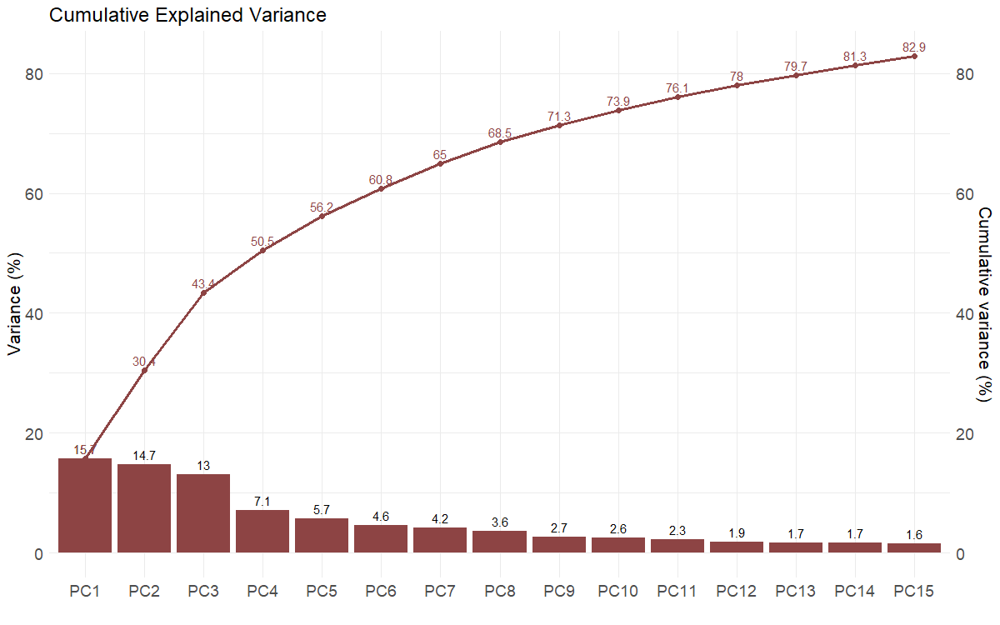{.absolute top="260" left="43" width="553" height="346"}

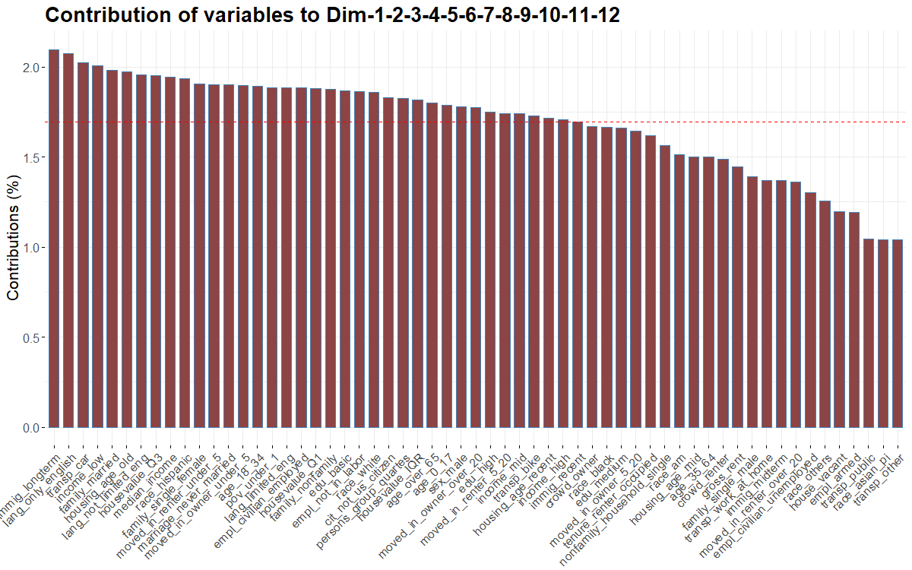{.absolute top="266" left="621" width="616" height="385"}

## Redukcja zmiennych [II. PCA]{.etap}

::: {.absolute top="99" left="64" width="400"}
[Etap 3]{.podtytul}
:::

::: {.absolute .justify top="163" left="64" width="1152"}
41 zmiennych zredukowano do **12 nieskorelowanych składowych głównych**, które łącznie wyjaśniały **89%** całkowitej wariancji zbioru danych.
:::

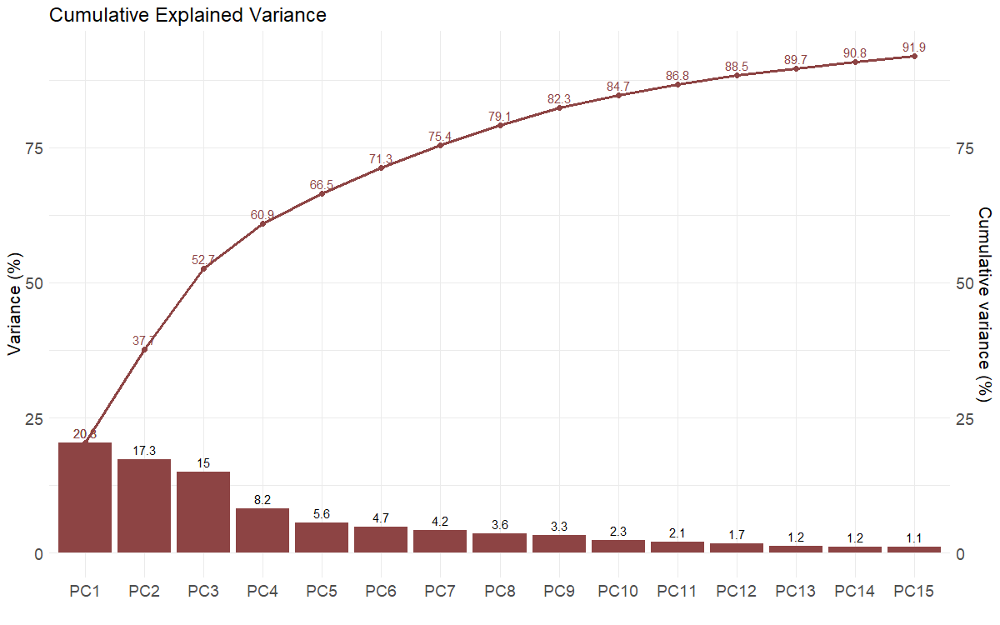{.absolute top="240" left="273" width="733" height="458"}

## Ładunki komponentów [II. PCA]{.etap}

::: {.absolute .justify top="115" left="64" width="1152"}
W oparciu o wyniki PCA wyodrębniono **ładunki czynnikowe** (ang. *loadings*), czyli współczynniki korelacji zmiennych z poszczególnymi składowymi głównymi.

Wysokie wartości dodatnie oznaczają [**silną korelację dodatnią**]{style="color:#C00000"} danej zmiennej ze składową główną, wysokie wartości ujemne natomiast – [**silną korelację ujemną**]{style="color:#005A9E"} między zmienną a składową.
:::

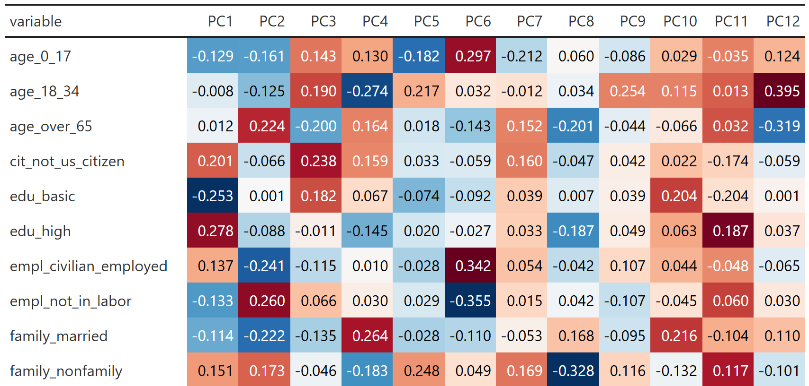{.absolute top="250" left="232" width="815" height="390"}

::: {.absolute .center-text .f24 top="658" left="112" width="1057"}
**Szczególnym wyzwaniem jest precyzyjna interpretacja znaczenia poszczególnych elementów.**
:::

## Mapy wartości komponentów [II. PCA]{.etap}

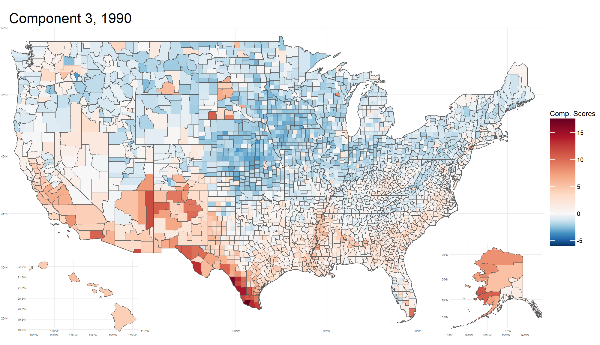{.absolute top="109" left="135" width="1009" height="580"}

## Mapy wartości komponentów [II. PCA]{.etap}

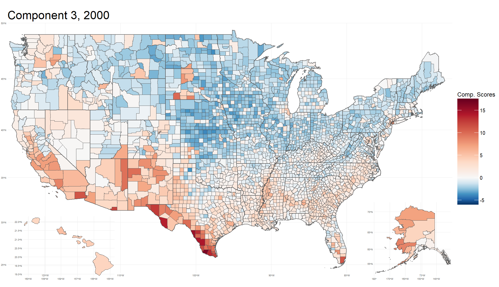{.absolute top="109" left="135" width="1009" height="580"}

## Mapy wartości komponentów [II. PCA]{.etap}

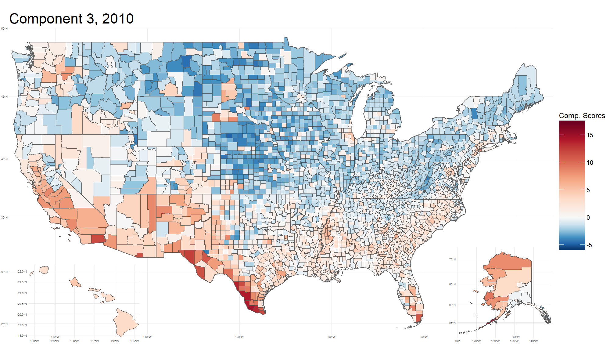{.absolute top="109" left="135" width="1009" height="580"}

## Mapy wartości komponentów [II. PCA]{.etap}

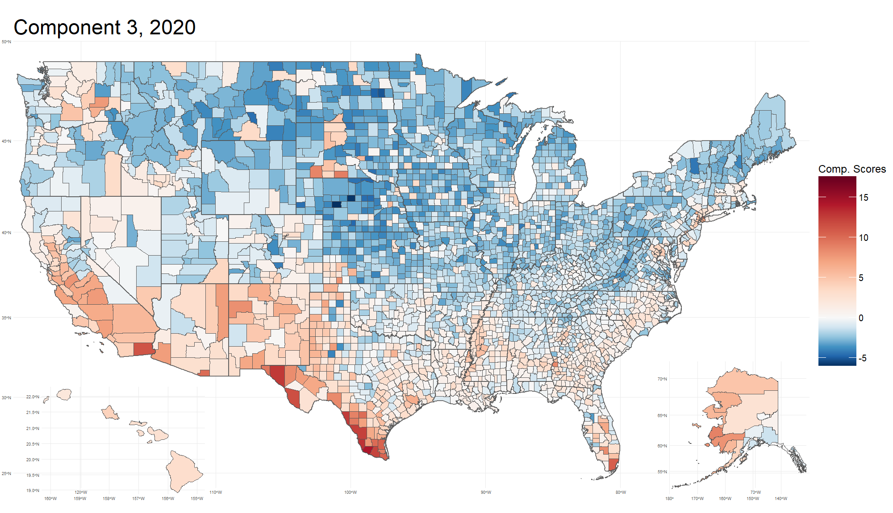{.absolute top="109" left="135" width="1009" height="580"}

## Mapy wartości komponentów [II. PCA]{.etap}

::: {.absolute .ramka-jasna .f20 top="119" left="64" width="312" height="55"}
Czynniki ładunkowe zmiennych
:::

::: {.absolute .ramka-jasna .f20 top="119" left="401" width="394" height="55"}
Wpływ zmiennych na składowe główne
:::

::: {.absolute .ramka-jasna .f20 top="119" left="822" width="394" height="55"}
Rozkład przestrzenny wartości składowych
:::

::: {.absolute .ramka-jasna .f20 top="282" left="375" width="447" height="55"}
**Interpretacja profili demograficznych**
:::

```{=html}
<svg style="position:absolute;top:0;left:0;pointer-events:none" width="1280" height="720" viewBox="0 0 1280 720">
  <defs><marker id="grot19" markerWidth="8" markerHeight="8" refX="7" refY="4" orient="auto"><path d="M0 0L8 4L0 8z" fill="#4A5A53"/></marker></defs>
  <path d="M220 174 V309 H372" fill="none" stroke="#4A5A53" stroke-width="1.2" marker-end="url(#grot19)"/>
  <path d="M598 174 V279" fill="none" stroke="#4A5A53" stroke-width="1.2" marker-end="url(#grot19)"/>
  <path d="M1019 174 V309 H825" fill="none" stroke="#4A5A53" stroke-width="1.2" marker-end="url(#grot19)"/>
</svg>
```

::: {.absolute .center-text top="418" left="64" width="1152"}
Na podstawie interpretacji wyników PCA opisano każdy z 12 komponentów jako składowe **profili społeczno-demograficznych**, co pozwoliło na lepszą interpretację modelu uczenia maszynowego.
:::

## III. Modelowanie [III. Modelowanie]{.etap}

::: {.aktywny-3}

:::

## Zmienna objaśniana [III. Modelowanie]{.etap}

::: {.absolute .justify top="113" left="64" width="1152"}
Celem było zbadanie, w jaki sposób 12 składowych głównych wpływa na segregację rasowo-etniczną, przy czym [**wartość 0 oznacza pełną integrację**]{style="color:#FFC000"} obu grup, a **1 – całkowitą segregację**.
:::

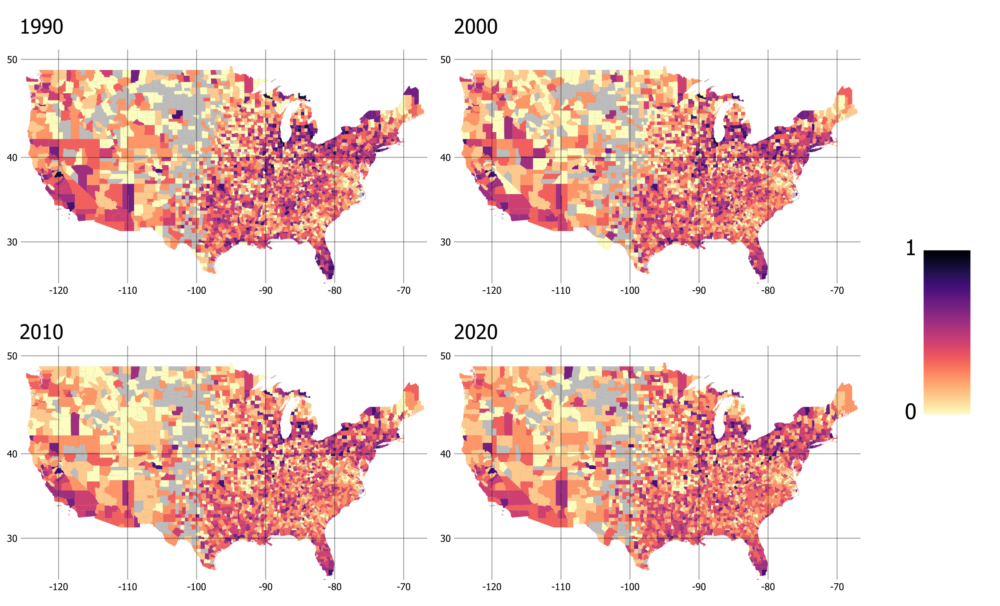{.absolute top="175" left="268" width="843" height="511"}

## Ocena modeli [III. Modelowanie]{.etap}

::: {.absolute top="112" left="64" width="1152"}
Łącznie wytrenowano **28 modeli uczenia maszynowego** (4 lata x 7 wskaźników).
:::

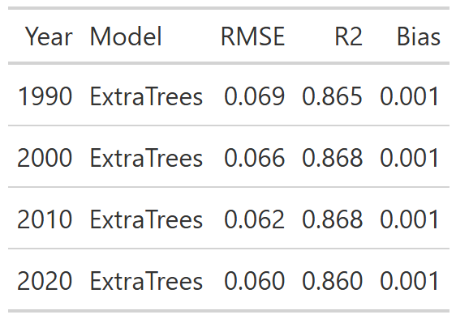{.absolute top="216" left="111" width="321" height="225"}

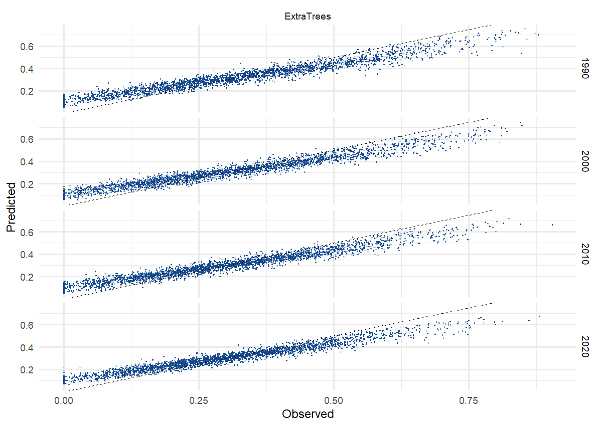{.absolute top="174" left="511" width="698" height="495"}

::: {.absolute .justify top="509" left="64" width="429"}
Z uwagi na m.in. wyniki kroswalidacji, do dalszej dekompozycji i interpretacji wybrano model **ExtraTrees**.
:::

## IV. SHAP [IV. SHAP]{.etap}

::: {.aktywny-4}

:::

## Interpretowalne uczenie maszynowe [IV. SHAP]{.etap}

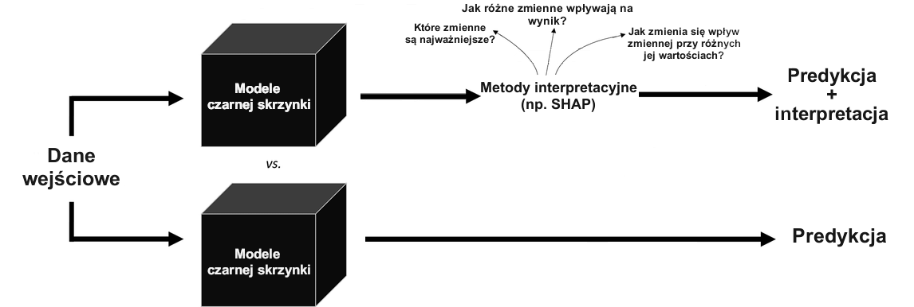{.absolute top="195" left="8" width="1223" height="412"}

## Istotność komponentów [IV. SHAP]{.etap}

::: {.absolute .justify top="119" left="64" width="1152"}
Obliczenie wartości SHAP umożliwiło uzyskanie istotności składowych głównych (ang. *feature importance plots*), wskazując ich wpływ na wyniki modelu w każdym roku.
:::

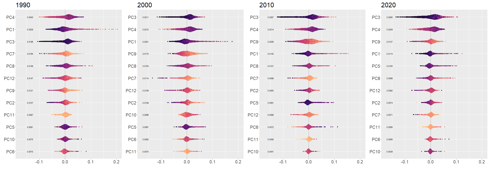{.absolute top="200" left="8" width="1152" height="427"}

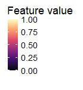{.absolute top="353" left="1166" width="110" height="125"}

## Wykresy zależności [IV. SHAP]{.etap}

::: {.absolute .justify top="121" left="64" width="1152"}
Za pomocą metody SHAP uzyskano także wykresy zależności (ang. *dependence plots*) przedstawiające relację między wartościami wybranej składowej głównej (oś pozioma) a wynikiem modelu (oś pionowa), gdzie każda obserwacja odpowiada pojedynczemu hrabstwu.

[**Im wyższa wartość SHAP powyżej zera**]{style="color:#C00000"}, tym wyższy przewidywany poziom segregacji między Białymi a Czarnymi, [**im niższa wartość SHAP poniżej zera**]{style="color:#002060"} – tym mniejszy.
:::

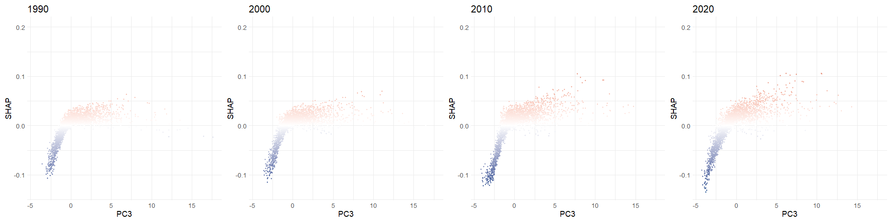{.absolute top="338" left="46" width="1188" height="297"}

## Mapy wpływu komponentów [IV. SHAP]{.etap}

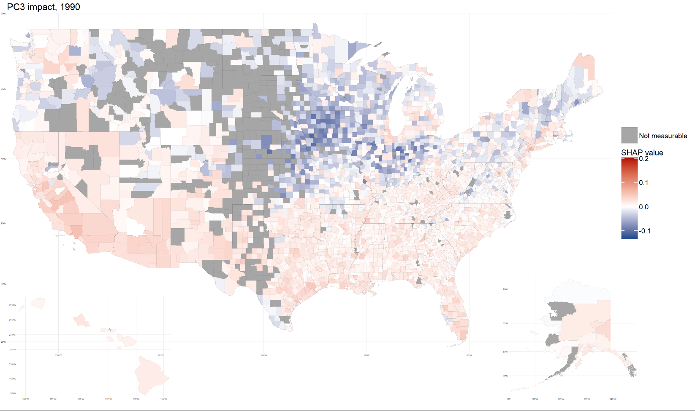{.absolute top="123" left="64" width="961" height="570"}

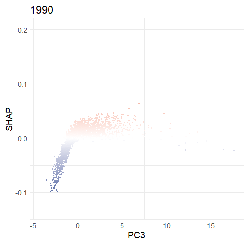{.absolute top="386" left="982" width="260" height="260"}

## Mapy wpływu komponentów [IV. SHAP]{.etap}

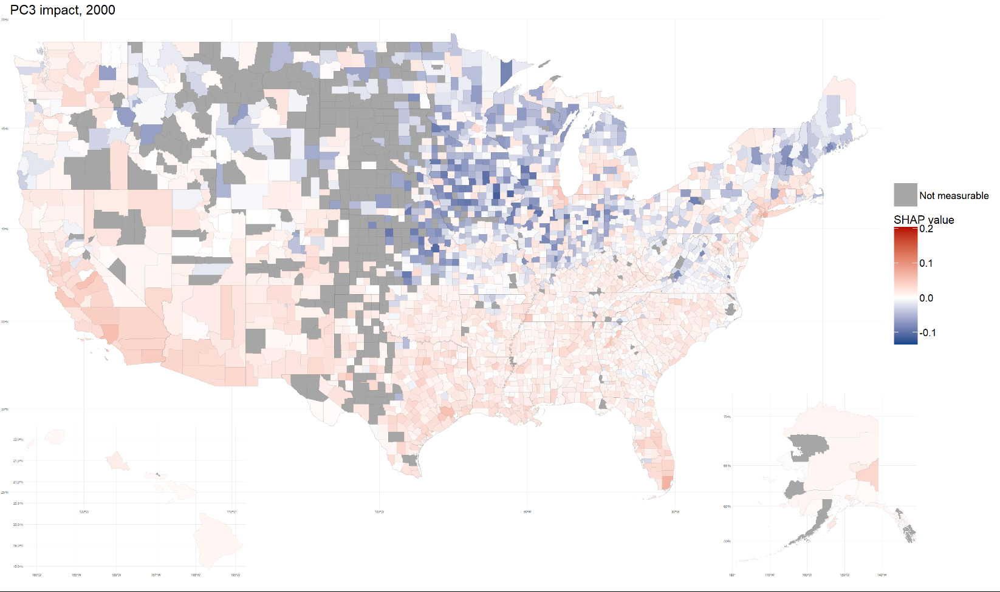{.absolute top="123" left="64" width="961" height="570"}

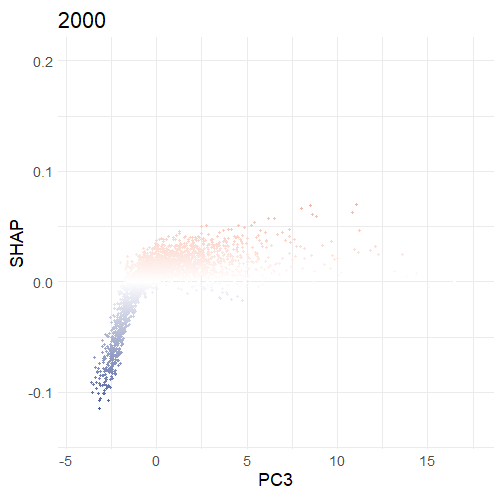{.absolute top="386" left="982" width="260" height="260"}

## Mapy wpływu komponentów [IV. SHAP]{.etap}

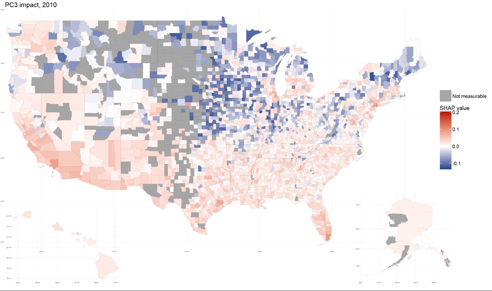{.absolute top="123" left="64" width="961" height="570"}

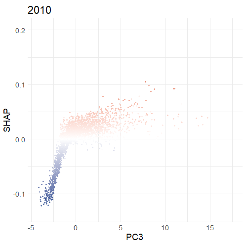{.absolute top="386" left="982" width="260" height="260"}

## Mapy wpływu komponentów [IV. SHAP]{.etap}

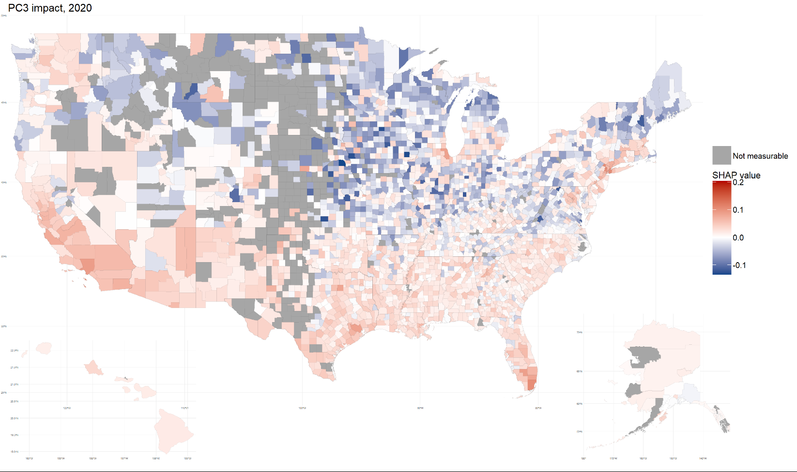{.absolute top="123" left="64" width="961" height="570"}

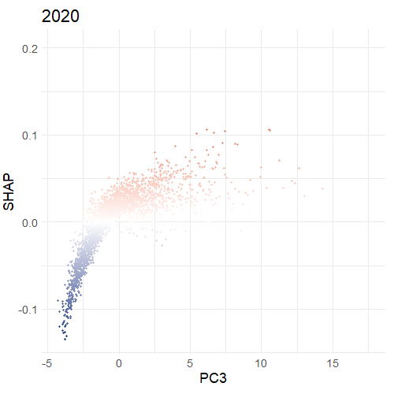{.absolute top="386" left="982" width="260" height="260"}

## {.bez-tytulu background-color="#436B5C"}

::: {.absolute .rozdzial top="276" left="66" width="1099"}
[Przykład 2]{.nr}

[Wynik wyborów prezydenckich]{.nazwa}
:::

::: {.absolute .rozdzial top="466" left="66" width="1099"}
Identyfikacja przestrzennych profili społeczno-demograficznych wpływających na wzorce głosowania w wyborach prezydenckich w USA w latach 2008–2024
:::

## I. Dane [I. Dane]{.etap}

::: {.aktywny-1}

:::

## II. Analiza składowych głównych (PCA) [II. PCA]{.etap}

::: {.aktywny-2}

:::

## Redukcja zmiennych [II. PCA]{.etap}

::: {.absolute .ramka-jasna top="119" left="65" width="340" height="58"}
**77 zmiennych**
:::

::: {.absolute .ramka-jasna top="119" left="470" width="340" height="58"}
**39 zmiennych**
:::

::: {.absolute .ramka-ciemna top="118" left="875" width="341" height="59"}
**12 składowych głównych**
:::

```{=html}
<svg style="position:absolute;top:138px;left:421px" width="34" height="20" viewBox="0 0 32 19"><path d="M0 6h20V0l12 9.5L20 19v-6H0z" fill="#9DB5AA"/></svg>
<svg style="position:absolute;top:138px;left:826px" width="34" height="20" viewBox="0 0 32 19"><path d="M0 6h20V0l12 9.5L20 19v-6H0z" fill="#9DB5AA"/></svg>
```

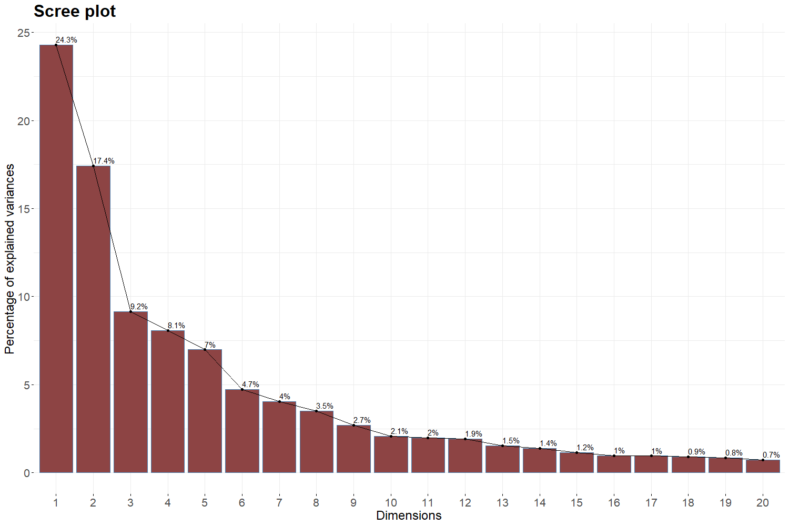{.absolute top="193" left="266" width="747" height="498"}

## Ładunki czynnikowe [II. PCA]{.etap}

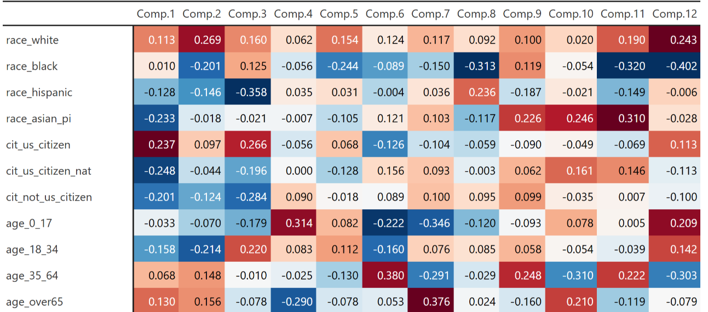{.absolute top="150" left="73" width="1143" height="505"}

## Mapy wartości komponentów [II. PCA]{.etap}

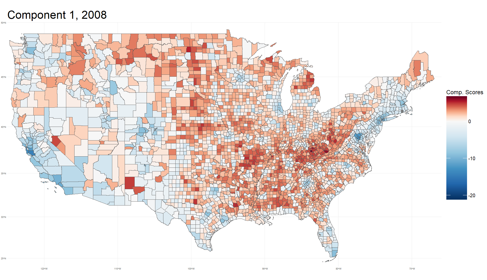{.absolute top="115" left="131" width="1019" height="586"}

## Mapy wartości komponentów [II. PCA]{.etap}

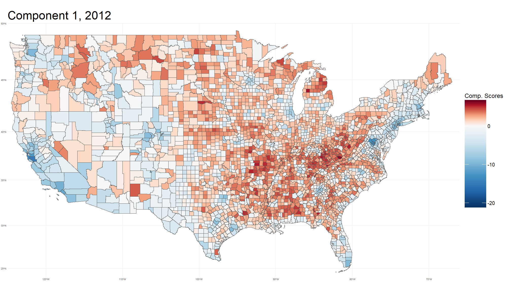{.absolute top="115" left="131" width="1019" height="586"}

## Mapy wartości komponentów [II. PCA]{.etap}

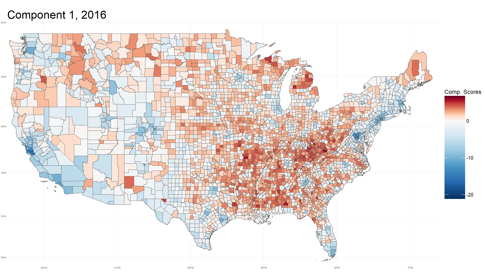{.absolute top="115" left="131" width="1019" height="586"}

## Mapy wartości komponentów [II. PCA]{.etap}

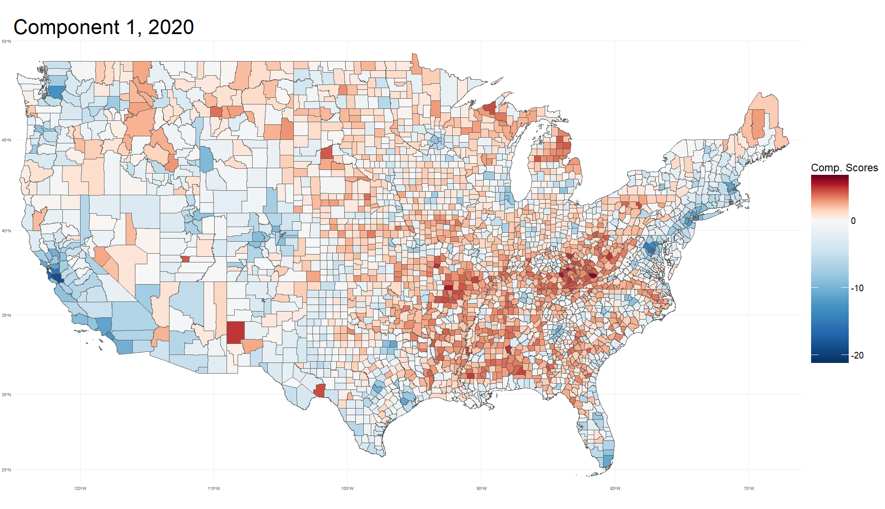{.absolute top="115" left="131" width="1019" height="586"}

## Mapy wartości komponentów [II. PCA]{.etap}

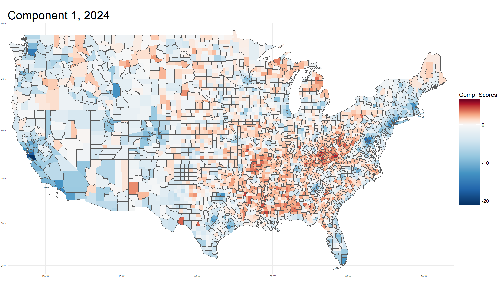{.absolute top="115" left="131" width="1019" height="586"}

## III. Modelowanie [III. Modelowanie]{.etap}

::: {.aktywny-3}

:::

## Zmienna objaśniana [III. Modelowanie]{.etap}

::: {.absolute .justify top="113" left="64" width="1152"}
Zmienną objaśnianą był wynik wyborczy wyrażony jako procent różnicy głosów pomiędzy kandydatem [**Partii Demokratycznej (< 0)**]{style="color:#005A9E"} a [**Partii Republikańskiej (> 0).**]{style="color:#C00000"}
:::

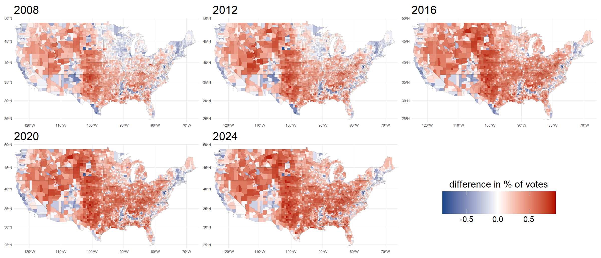{.absolute top="184" left="61" width="1155" height="497"}

## Ocena modeli [III. Modelowanie]{.etap}

::: {.absolute top="112" left="64" width="1152"}
Łącznie wytrenowano **5 modeli uczenia maszynowego** (5 lat x 1 zmienna zależna).
:::

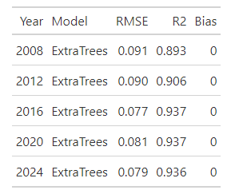{.absolute top="257" left="95" width="284" height="243"}

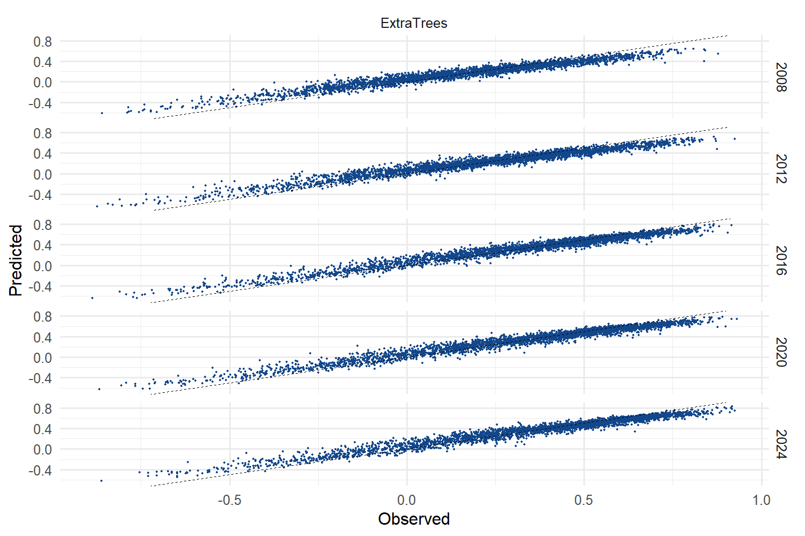{.absolute top="160" left="445" width="771" height="514"}

## IV. SHAP [IV. SHAP]{.etap}

::: {.aktywny-4}

:::

## Istotność komponentów [IV. SHAP]{.etap}

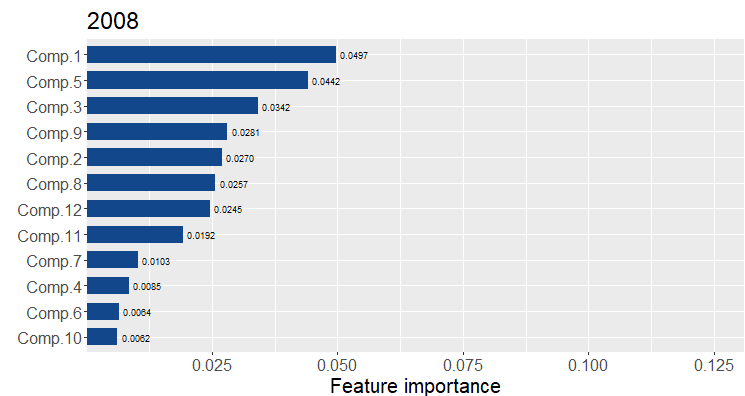{.absolute top="128" left="161" width="959" height="510"}

## Istotność komponentów [IV. SHAP]{.etap}

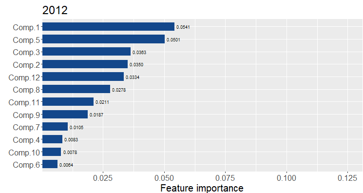{.absolute top="128" left="161" width="959" height="510"}

## Istotność komponentów [IV. SHAP]{.etap}

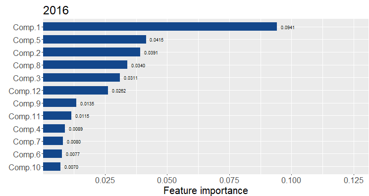{.absolute top="128" left="161" width="959" height="510"}

## Istotność komponentów [IV. SHAP]{.etap}

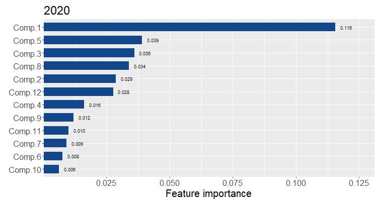{.absolute top="128" left="161" width="959" height="510"}

## Istotność komponentów [IV. SHAP]{.etap}

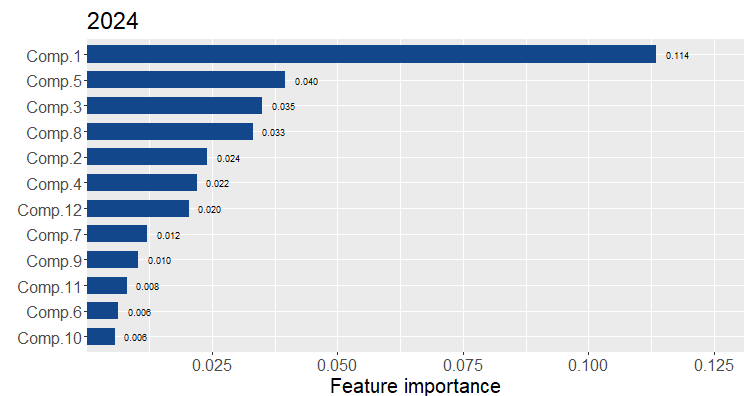{.absolute top="128" left="161" width="959" height="510"}

## Wykresy zależności [IV. SHAP]{.etap}

::: {.absolute .justify top="110" left="64" width="1152"}
[**Im wyższa wartość SHAP powyżej zera**]{style="color:#C00000"}, tym większe przewidywane poparcie dla kandydata [**Partii Republikańskiej**]{style="color:#C00000"}, [**im niższa wartość SHAP poniżej zera**]{style="color:#005A9E"} – tym większe dla kandydata [**Partii Demokratycznej**]{style="color:#005A9E"}.
:::

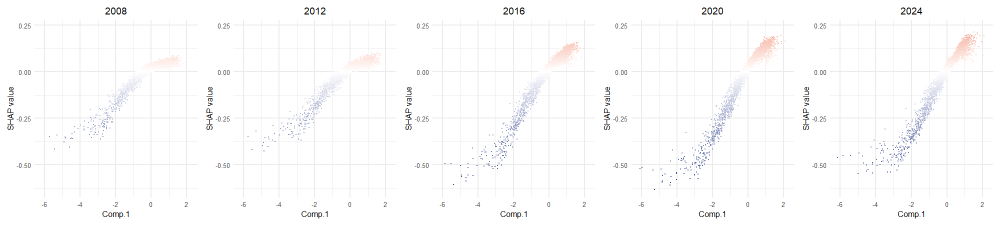{.absolute top="196" left="64" width="1156" height="260"}

::: {.absolute .center-text .f24 top="510" left="64" width="1152"}
**Komponent 1** różnicuje uboższe i słabiej wykształcone hrabstwa peryferyjne od hrabstw zurbanizowanych, lepiej wykształconych i bardziej zamożnych.
:::

## Mapy wpływu komponentów [IV. SHAP]{.etap}

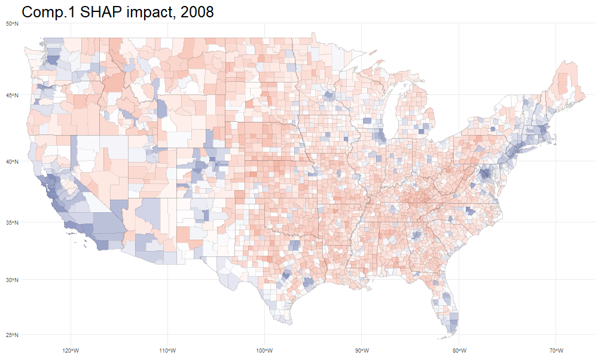{.absolute top="130" left="184" width="912" height="544"}

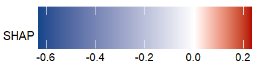{.absolute top="555" left="909" width="338" height="92"}

## Mapy wpływu komponentów [IV. SHAP]{.etap}

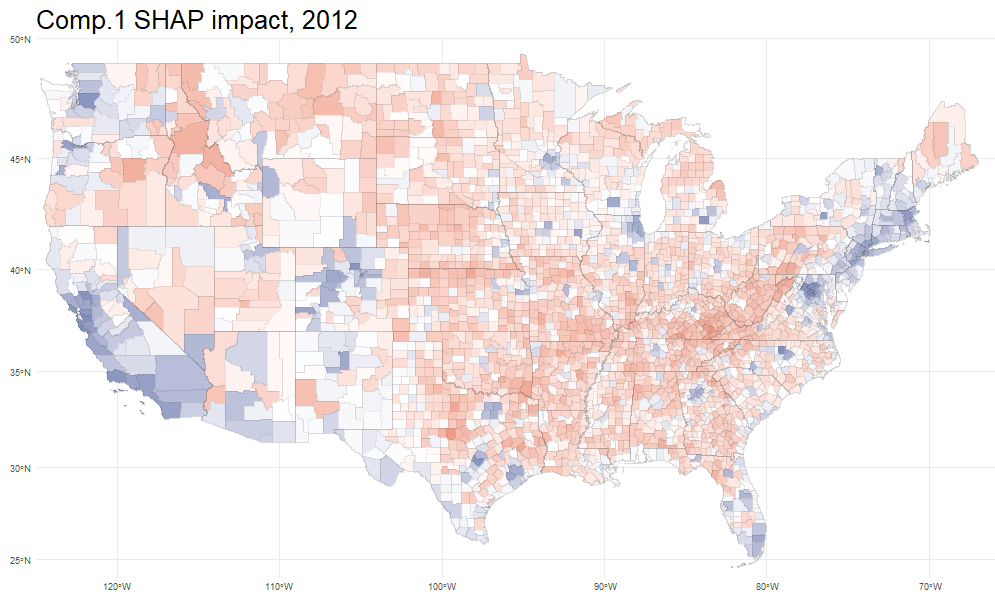{.absolute top="130" left="184" width="912" height="544"}

{.absolute top="555" left="909" width="338" height="92"}

## Mapy wpływu komponentów [IV. SHAP]{.etap}

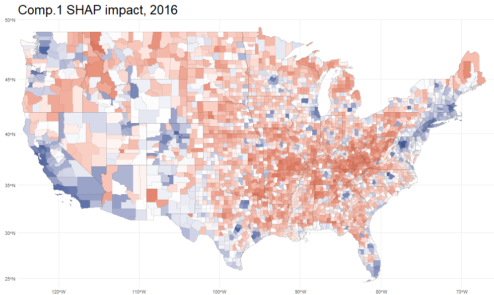{.absolute top="130" left="184" width="912" height="544"}

{.absolute top="555" left="909" width="338" height="92"}

## Mapy wpływu komponentów [IV. SHAP]{.etap}

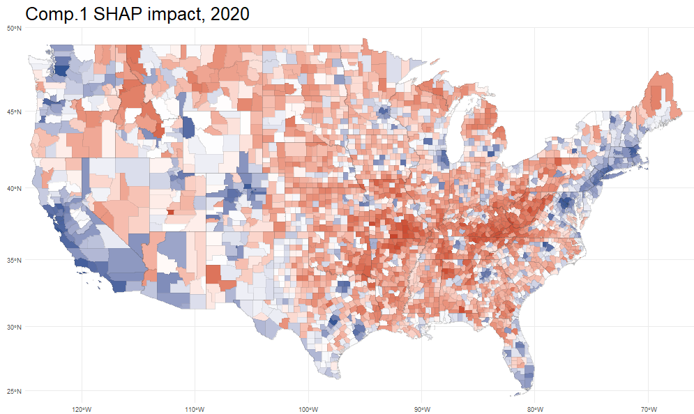{.absolute top="130" left="184" width="912" height="544"}

{.absolute top="555" left="909" width="338" height="92"}

## Mapy wpływu komponentów [IV. SHAP]{.etap}

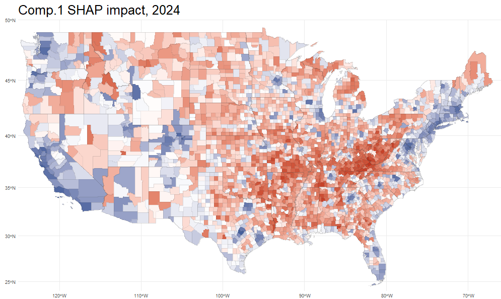{.absolute top="130" left="184" width="912" height="544"}

{.absolute top="555" left="909" width="338" height="92"}

## Podsumowanie

::: {.absolute top="126" left="64" width="744"}
- Wykorzystanie IML **pozwoliło na szczegółową interpretację zależności** między profilami społeczno-ekonomicznymi a wskaźnikami segregacji rasowo-etnicznej (1) oraz wynikami wyborów prezydenckich (2).
- Połączenie **PCA, metod uczenia maszynowego i wartości SHAP** pozwala analizować duże zbiory danych geoprzestrzennych i interpretować wyniki czasowo-przestrzennie.
- Analiza składowych głównych na całym zbiorze dla wszystkich lat **umożliwia porównywanie roli komponentów między różnymi okresami**.
- **Procedurę tę można zastosować do dowolnej zmiennej zależnej** opisanej dla jednostek przestrzennych w badaniach **dowolnej dziedziny**.
:::

::: {.absolute .panel top="126" left="830" width="386" height="560"}
[Kontakt]{.naglowek-panel}

adrian.nowacki@amu.edu.pl

<br>

[Prezentacja]{.naglowek-panel}

[adrian-nowacki.github.io/ptip2026](https://adrian-nowacki.github.io/ptip2026)
:::

